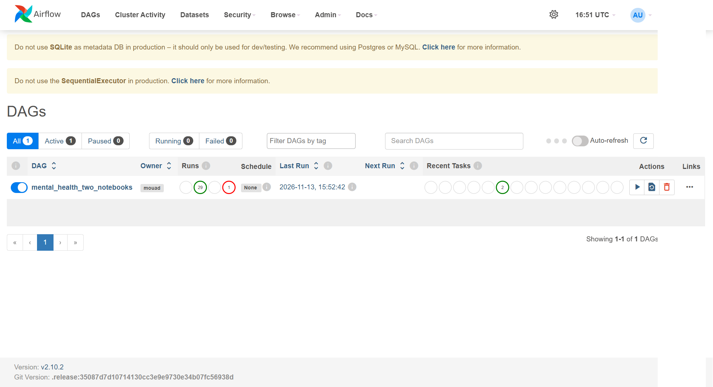
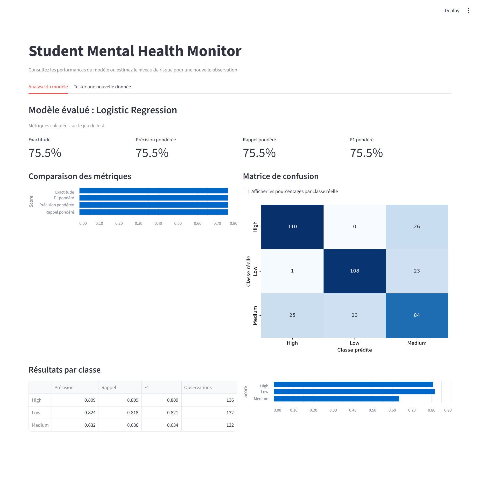
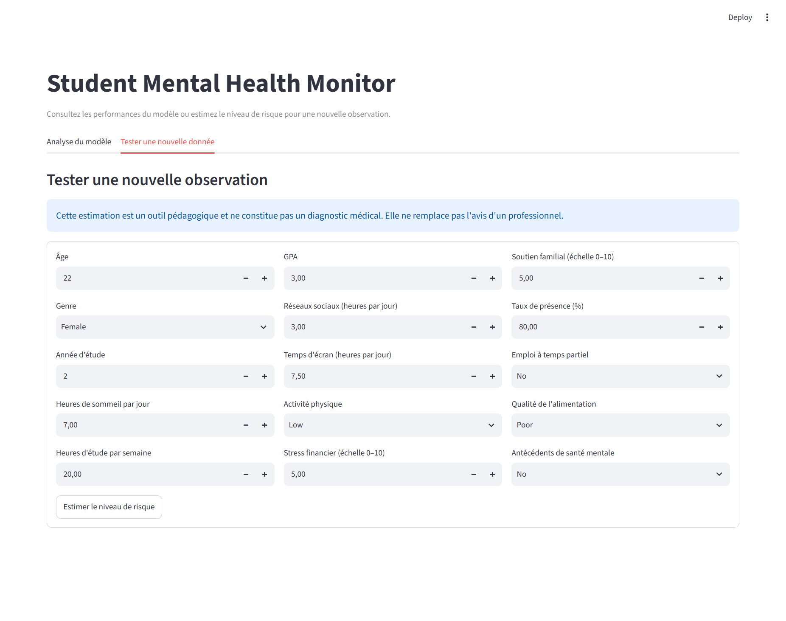

# Student Mental Health Monitor

Application de démonstration qui analyse les facteurs liés à la santé mentale
des étudiants, entraîne un modèle de classification et permet d'explorer ses
résultats avec Streamlit.

> **Important :** les prédictions sont expérimentales et ne constituent pas un
> diagnostic médical ni un avis professionnel.

## Données

Le fichier `data/raw/student_mental_health.csv` contient 2 000 observations et
17 colonnes : un identifiant, 15 variables descriptives et la cible
`Mental_Health_Risk` (`Low`, `Medium`, `High`). `Student_ID` est exclu de
l'entraînement. L'EDA signale les valeurs manquantes et anomalies; elle ne
supprime pas de lignes.

## Démarche

1. `notebooks/01_eda.ipynb` examine les distributions, les valeurs manquantes,
   les anomalies et les relations entre variables.
2. `notebooks/02_preprocessing.ipynb` crée une séparation stratifiée
   entraînement/test de 80/20. Les imputations, le scaling et les encodages sont
   ajustés dans des pipelines sur les données d'entraînement.
3. Les modèles et hyperparamètres sont comparés par validation croisée à
   5 plis. Le jeu de test est réservé à l'évaluation finale du modèle retenu.
4. Le pipeline, l'encodeur des classes et les métriques sont enregistrés dans
   `models/`.

## Résultats

Modèle retenu : **Logistic Regression**. Scores sur le jeu de test :

| Métrique | Score |
|---|---:|
| Exactitude | 75,50 % |
| Précision pondérée | 75,55 % |
| Rappel pondéré | 75,50 % |
| F1 pondéré | 75,52 % |

Matrice de confusion (lignes : classe réelle; colonnes : classe prédite) :

| Réelle \ Prédite | High | Low | Medium |
|---|---:|---:|---:|
| High | 110 | 0 | 26 |
| Low | 1 | 108 | 23 |
| Medium | 25 | 23 | 84 |

Les valeurs sont également disponibles dans `models/evaluation_metrics.json`.

## Installation et exécution

### Airflow avec Docker

Prérequis : Docker Desktop avec le moteur Linux/WSL 2 démarré.

Depuis la racine du projet :

```bash
docker compose up --build
```

Ouvrir [http://localhost:8080](http://localhost:8080), récupérer le mot de
passe `admin` dans les logs au premier démarrage, puis déclencher
`mental_health_two_notebooks` dans l'interface. Le DAG exécute les notebooks
dans l'ordre et ne se lance pas automatiquement. Les copies exécutées sont
enregistrées dans `airflow/output_notebooks/`; les notebooks sources restent
dans `notebooks/`.

Arrêter les conteneurs avec `Ctrl+C` ou `docker compose down`.

### Application Streamlit

Avec Python installé, depuis la racine du projet :

```bash
python -m pip install -r requirement.txt
python -m streamlit run app/streamlit_app.py
```

Ouvrir [http://localhost:8501](http://localhost:8501). L'application propose
l'analyse des métriques et de la matrice de confusion, ainsi qu'un formulaire
pour tester une nouvelle observation.

## Captures d'écran

Les captures suivantes montrent l'interface Airflow et les deux vues Streamlit.

### Airflow



### Streamlit — analyse du modèle



### Streamlit — formulaire de prédiction



## Structure du projet

```text
airflow/
  dags/mental_health_dag.py
  output_notebooks/               # résultats générés par Papermill
app/streamlit_app.py
data/raw/student_mental_health.csv
models/                           # pipeline, encodeur et métriques
notebooks/
  01_eda.ipynb
  02_preprocessing.ipynb          # entraînement et évaluation
Dockerfile
docker-compose.yml
requirement.txt
```
